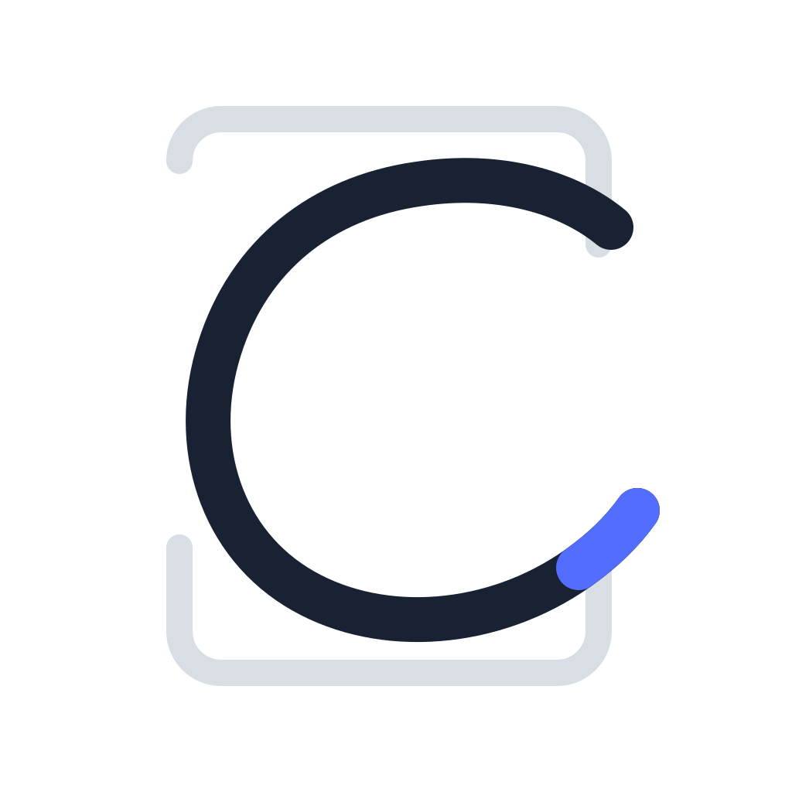
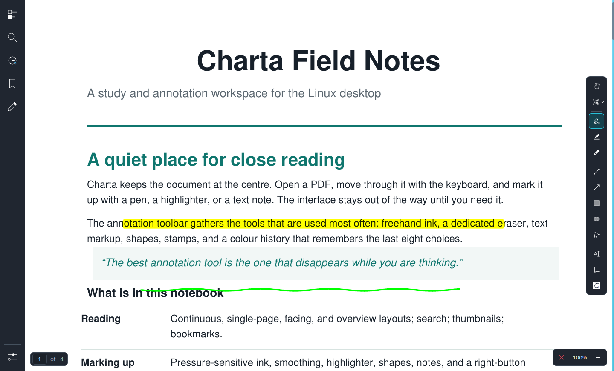
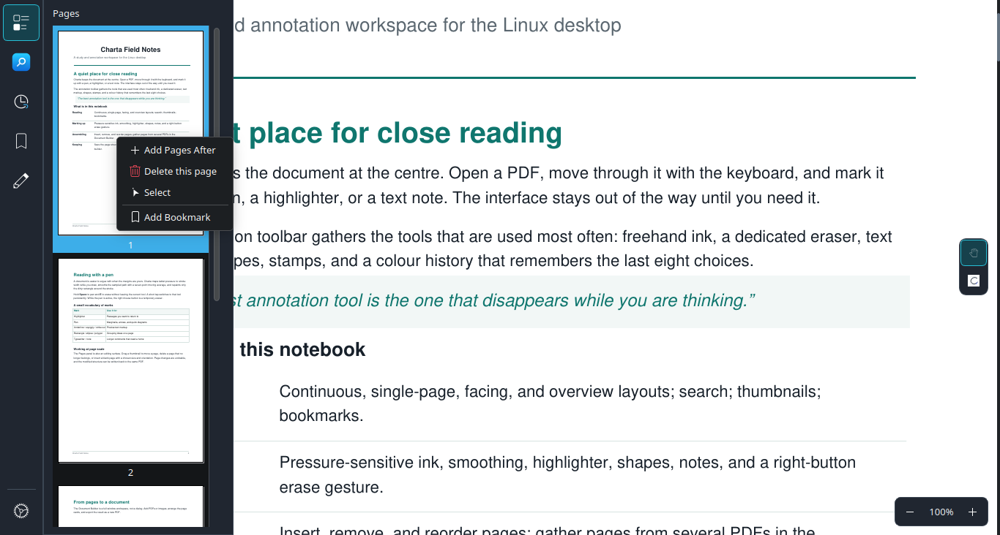
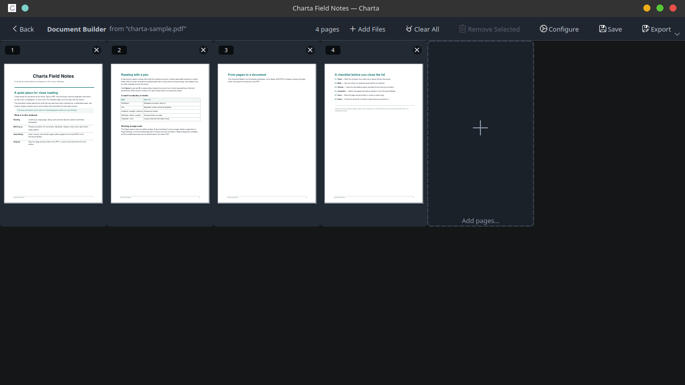
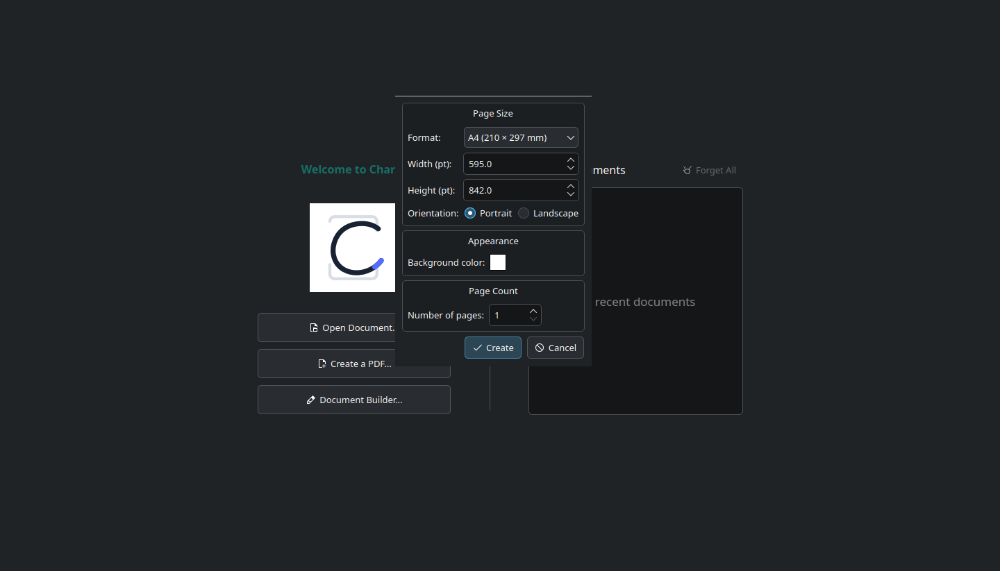
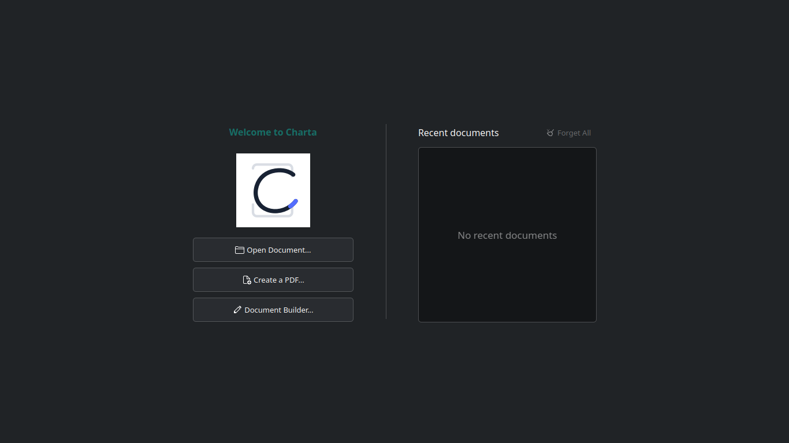

# Charta



**A study- and annotation-focused document reader for the Linux desktop, built on KDE Okular.**

> **Status: early-usable prototype.** Linux desktop is the only target platform. Some features
> are experimental or incomplete, behaviour may change between commits, and there is no CI or
> tagged release. This project is being refactored by its creator ahead of a public release.

Charta is substantially based on [KDE Okular](https://okular.kde.org/). It is **not** an official
KDE or Okular release and is not affiliated with or endorsed by the KDE community. It keeps
Okular's document core and format backends and adds a drawing-first annotation workflow,
in-place PDF page editing, a visual Document Builder, and a "Create a PDF" flow.

## Contents

[About](#about) · [Feature status](#feature-status) · [Features](#features) ·
[Requirements](#requirements) · [Building from source](#building-from-source) ·
[Running charta](#running-charta) · [Tests](#tests) · [Supported formats](#supported-formats) ·
[Known limitations](#known-limitations) · [Documentation](#documentation) ·
[Attribution and provenance](#attribution-and-provenance) · [License](#license) ·
[Contributing and reporting issues](#contributing-and-reporting-issues) ·
[Acknowledgements](#acknowledgements) · [Project facts](#project-facts)

## About

Charta is a PDF reader and annotation tool for the Linux desktop. It is built on KDE Okular's
document engine and adds:

- **Drawing-first annotation** — pressure-sensitive pen, freeform highlighter, dedicated eraser,
  shapes, stamps, and a recent-colour history.
- **Temporary tools** — hold **Space** to pan or **E** to erase; release to return to your tool.
- **In-place PDF page editing** — insert, delete, and reorder pages with undo/redo.
- **Document Builder** — assemble a new PDF from pages of other PDFs and from images.
- **Create a PDF** — start from configured blank pages and `Save As`.

### How this was built

The code in this repository was generated with AI tools under the direction of its project
creator and maintainer, who integrated and tested the work. AI systems are disclosed as tools,
not authors or copyright holders. The creator is currently studying computer science and plans
to refactor parts of the codebase personally before a public release, so that the shipped code
can be claimed as their own work.

This statement describes the development process. It is not a substitute for copyright
attribution, and no legal clearance has been obtained for AI-generated output. See
[Attribution and provenance](#attribution-and-provenance) and
[docs/licensing/](docs/licensing/) for the full position.



*Reading and annotating a PDF in Charta.*

## Feature status

"Implemented" means the code exists in the tree, not that it is fully tested. See
[Tests](#tests) and [docs/README-VERIFICATION.md](docs/README-VERIFICATION.md).

| Area | Status | Notes |
|---|---|---|
| PDF viewing and navigation | Implemented (inherited) | Poppler backend; the main use case |
| Text markup (highlight, underline, squiggly, strike out) | Implemented | |
| Freehand ink, freeform highlighter, eraser | Implemented | Pressure is session-only |
| Shapes: line, arrow, rectangle, ellipse, polygon | Implemented | |
| Select, move, resize annotations | Implemented | Click and lasso selection |
| Annotation rotation | Implemented | Text, stamp, shapes, line and ink; linked text, highlight and caret stay unrotated |
| PDF page insert / delete / reorder | Implemented | Poppler only; no dedicated test |
| Autosave | Implemented, guarded | No dedicated test |
| Document Builder | Implemented | Model and part-integration tests exist |
| Create a blank PDF | Implemented | Writer and untitled-document tests exist |
| Text annotation tool | Not ready | Maintainer-listed as not ready for use |
| Layer flattening | Not implemented | Layers can be viewed only |
| Non-PDF formats | Inherited, unverified | See [Supported formats](#supported-formats) |
| Mobile (Kirigami) UI | Inherited, unsupported | Present in tree, not claimed to work |

## Features

**Reading.** PDF rendering through Poppler with Okular's layouts, zoom, search, text selection,
thumbnails, contents, bookmarks, layers and signatures panels, tabs, and a welcome screen with
recent files. Presentation mode, forms, signatures and text-to-speech are inherited; they depend
on build options and the document.

**Annotation.**

- Tools: text markup, typewriter, inline and popup notes, pen, freeform highlighter, eraser,
  line, arrow, rectangle, ellipse, polygon, and stamps (including clipboard-image stamps).
- Per-point tablet pressure is captured and mapped to stroke width; a seven-point moving average
  smooths the path. While the pen is active, the right mouse button erases temporarily.
- Hold **Space** to pan or **E** to erase temporarily (hold threshold 180 ms); a tap switches
  tool persistently. A history of recent colours is cycled with **C**.

| Default shortcut | Action |
|---|---|
| `Alt+1` … `Alt+4` | Highlighter, underline, squiggly, strike out |
| `Alt+6` / `Alt+7` | Inline note / popup note |
| `Alt+Shift+T` | Typewriter |
| `1` | Pen |
| `B` / `Alt+Shift+S` | Lasso select / select tool |
| `Alt+Shift+E` | Eraser |
| `Alt+Shift+A` / `L` / `R` / `O` / `P` | Arrow / line / rectangle / ellipse / polygon |
| `Alt+Shift+B` | Drawing browse (pan) |
| `Ctrl+1` / `Ctrl+2` / `Ctrl+4` / `Ctrl+6` | Browse / zoom / text select / magnifier |
| `F6` | Toggle annotation toolbar |
| `C` | Cycle annotation colour |
| `Ctrl+Shift+Delete` | Clear annotations on the current page |
| `Ctrl+Shift+B` | Open Document Builder (shell); also bound to "add to quick tools" in the part |

All shortcuts are configurable. The `Ctrl+Shift+B` double binding is a confirmed inconsistency:
when an annotation tool is active, the shortcut can show an ambiguity warning and trigger neither
action; use `File → Document Builder…` in that case. See
[Known limitations](#known-limitations).

**Page editing (PDF, Poppler backend).** Insert blank pages, delete pages (the last page cannot
be removed), reorder by dragging thumbnails, undo/redo, and save in place. Saving a changed
structure uses QPDF when built with it, otherwise `pdfseparate`/`pdfunite` from poppler-utils.



*The Pages panel, used for thumbnail navigation and page editing.*

**Document Builder.** A full-window page, opened from the options rail, the welcome screen, or
`File → Document Builder…`.



*Assembling pages in the Document Builder.*

1. **Add Files** accepts local PDFs and images; password-protected PDFs prompt for a password.
2. Pages appear as thumbnail cards; reorder by drag, `Alt+Up`/`Alt+Down`, or context menu.
3. Remove pages, adjust the grid, and set page size, margin and fit for image pages.
4. **Export** writes a new PDF (all or selected pages). **Save** deliberately replaces the PDF
   the builder was seeded from, after confirmation, then reloads it.

Export safeguards: output goes to a temporary file in the destination directory, is re-opened
and page-counted, then moved into place; on POSIX the final move is an atomic `rename`. An
output path resolving to a source file is refused (Save is the only exception). Only page
content is copied: outlines, form fields, attachments, metadata, signatures and encryption are
not carried over, and links may point to pages absent from the new file. Export is synchronous
and cannot be cancelled. Internals: [docs/architecture.md](docs/architecture.md).

**Create a PDF.** `File → New` or the welcome screen creates an untitled document backed by a
temporary blank-page PDF; `Save As` makes it a normal document. Autosave never runs on it.



*Creating a new PDF from blank pages.*

## Requirements

**Mandatory (CMake `REQUIRED`):** CMake ≥ 3.22; C++20 compiler; Qt ≥ 6.6 (Core, Test, Widgets,
PrintSupport, Svg, Xml); KDE Frameworks 6 (Archive, Bookmarks, Completion, Config, ConfigWidgets,
CoreAddons, I18n, KIO, ThreadWeaver, WindowSystem, XmlGui, IconThemes; for the desktop UI also
Parts, ColorScheme, Crash, TextWidgets, WidgetsAddons); Extra CMake Modules; zlib.

**Poppler Qt6 ≥ 24.08** is declared optional in CMake, but it provides the PDF backend and is
effectively required. The Poppler generator (`generators/poppler/annots.cpp`) calls
`setAppearanceStream`, `moveAnnotation` and `setUserRotation` without any feature guard. These
are not part of stock Poppler, so the [patched fork](#patched-poppler) is the supported choice
and a build against stock Poppler is not expected to compile (not tested).

**Optional:** QPDF (fetched as v11.9.1 if absent; otherwise page saving falls back to
`pdfseparate`/`pdfunite`), Qt6 DBus/Qml/TextToSpeech/MultimediaWidgets, KF6 Wallet/Purpose,
Freetype, libtiff, LibSpectre ≥ 0.2, KExiv2Qt6, DjVuLibre, ebook-tools, QMobipocket6, Discount.

Linux (X11/Wayland) only; the build uses Qt private GUI headers.

## Building from source

### Patched Poppler

Charta needs three things stock Poppler does not offer: a way to attach a custom appearance
stream (`/AP`) to an annotation (used for pressure-shaped ink), annotation-order access
(`moveAnnotation`), and persistence for oriented annotation frames. The fork lives in
<https://github.com/Rupam3238/poppler-patch-for-charta-26.08.0> (GPL-2.0, like upstream).
[`patches/poppler-ink-appearance.patch`](patches/poppler-ink-appearance.patch) covers the ink
appearance, and [`patches/poppler-annotation-rotation.patch`](patches/poppler-annotation-rotation.patch)
covers `ChartaRotate`/`ChartaLocalW`/`ChartaLocalH` metadata and the rotated `/AP` wrapper.
Neither patch is sufficient on its own for the current tree. The fork repository contains a
committed `build/` directory, so build it out of tree:

```bash
git clone https://github.com/Rupam3238/poppler-patch-for-charta-26.08.0.git "$HOME/poppler-charta-src"
cmake -S "$HOME/poppler-charta-src" -B "$HOME/poppler-charta-build" \
  -DCMAKE_BUILD_TYPE=Release -DCMAKE_INSTALL_PREFIX="$HOME/.local/poppler-charta" \
  -DENABLE_QT6=ON -DENABLE_QT5=OFF -DBUILD_QT6_TESTS=OFF
cmake --build "$HOME/poppler-charta-build" --parallel "$(nproc)"
cmake --install "$HOME/poppler-charta-build"
```

### Charta

```bash
export PKG_CONFIG_PATH="$HOME/.local/poppler-charta/lib/pkgconfig:$PKG_CONFIG_PATH"
export LD_LIBRARY_PATH="$HOME/.local/poppler-charta/lib:$LD_LIBRARY_PATH"   # to run from the build tree

git clone https://github.com/Rupam3238/Charta.git && cd Charta
cmake -S . -B build -DOKULAR_UI=desktop -DCMAKE_BUILD_TYPE=Release \
  -DCMAKE_PREFIX_PATH="$HOME/.local/poppler-charta"
cmake --build build --target charta --parallel "$(nproc)"
./build/bin/charta
```

Use `lib64` instead of `lib` if your Poppler installs there. Install with
`cmake --install build`. The first configure needs network access if no system QPDF is found.
Generators and `okularpart.so` are loaded as plugins: if code changes have no effect, check that
the build-tree plugins are used rather than a stale installed copy.

| CMake option | Default | Meaning |
|---|---|---|
| `OKULAR_UI` | `desktop` (Linux) | `desktop`, `mobile`, or `both` |
| `BUILD_TESTING` | CTest default | Build tests |
| `USE_DBUS` | ON on Linux/BSD | DBus components |
| `FORCE_NOT_REQUIRED_DEPENDENCIES` | empty | Downgrade listed packages from REQUIRED |
| `BUILD_COVERAGE` | OFF | gcov instrumentation |

### Flatpak

`.flatpak-manifest.json` (app ID `org.charta.reader`, runtime `org.kde.Platform` 6.11) builds
upstream Poppler 26.08.0 with only `patches/poppler-ink-appearance.patch`. It does **not** apply
`patches/poppler-annotation-rotation.patch` and does not use the full fork. Because the generator
calls the patched APIs unconditionally, this manifest is not expected to build until it is
updated (not tested). Treat the Flatpak as a work in progress.

```bash
flatpak-builder --user --install --force-clean build-dir .flatpak-manifest.json
flatpak run org.charta.reader
```

> **Verification:** these commands follow the CMake files and manifest at commit `0f13a44`. A clean build,
> install, and Flatpak build were **not** run for this documentation.

## Running charta



*The welcome screen shown on startup.*

```text
charta [options] [urls...]
```

Options (from `shell/main.cpp`): `-p/--page <n>`, `--presentation`, `--print`,
`--print-and-exit`, `--unique`, `--noraise`, `--find <string>`, `--editor-cmd <string>`. Run
`charta --help` for the authoritative list.

## Tests

```bash
cmake -S . -B build -DOKULAR_UI=desktop -DBUILD_TESTING=ON
cmake --build build --parallel "$(nproc)"
cd build && xvfb-run ctest --output-on-failure
```

The registered set in [`autotests/CMakeLists.txt`](autotests/CMakeLists.txt) depends on optional
features, so no fixed count is claimed. Charta-specific tests: `documentbuildermodeltest`,
`documentbuilderparttest`, `blankpageswritertest`, `untitleddocumenttest`, `widthpresetstest`,
`annotationcolorhistorytest`, `annotationtoolbartest`, `mainshelltest`, `annotationrotationtest`
(frame geometry, undo/redo, XML round trip), `annotationpersistencetest` (save and reopen through
Poppler; registered only when Poppler Qt6 is found) and `annotationclipboardtest` (desktop UI
only). **The suite was not run for this update.** Page editing, autosave, and the exporter's replacement rules have no dedicated
unit test.

## Supported formats

Charta inherits Okular's generator backends. This is a capability list, not a statement that
each format was tested, and availability depends on optional libraries found at configure time.
Viewing a format does not imply editing or saving works: annotation saving and page editing are
PDF-focused.

PDF (Poppler) is the primary, intended format. Inherited and unverified: DjVu, DVI, EPUB,
FictionBook, comic books, fax, images, Markdown, Mobipocket, PostScript, TIFF, plain text, XPS.
The Document Builder accepts PDFs and images readable by Qt's `QImageReader`.

## Known limitations

- Prototype quality; no CI. The Text annotation tool is not ready for use.
- Tablet pressure is session-only. Saved PDFs carry the pressure-shaped outline only through the
  custom `/AP` stream (patched Poppler); reopened strokes use ordinary PDF ink. Behaviour with
  stock Poppler was not verified.
- Annotation rotation covers text, stamps, shapes, line and ink. Linked text, highlight and caret
  annotations are deliberately kept unrotated, as are signatures and other action annotations.
  Layer flattening is not implemented.
- `Ctrl+Shift+B` is bound both to Document Builder (shell) and "add to quick tools" (part).
  With an annotation tool active, the ambiguity warning can block both actions; use
  `File → Document Builder…` instead.
- Page editing is Poppler-only. After a page edit, the original is removed and replaced, which is
  not guaranteed atomic. Links and named destinations may point to deleted pages.
- Autosave never runs for untitled, password-opened, non-local, print-preview, read-only, or
  data-losing-format documents, and refuses if the file's modification time changed on disk.
- Document Builder limitations are listed [above](#features).

## Documentation

- [docs/architecture.md](docs/architecture.md): layering, save pipelines, Document Builder.
- [docs/README-VERIFICATION.md](docs/README-VERIFICATION.md): claim-to-evidence mapping, checks
  performed, and unresolved questions.
- [docs/licensing/](docs/licensing/): provenance evidence, licence inventory, the third-party
  notices, the AGPL decision, and the per-release compliance checklist.
- [CONTRIBUTING.md](CONTRIBUTING.md): licence terms for contributions, SPDX header rules, and the
  rules for adding third-party code.

## Attribution and provenance

Charta retains applicable upstream components, copyright notices, and license terms, including
those from KDE Okular; existing notices remain with their files.

One annotation behaviour — the tablet pressure mapping — was derived from
[KDE Drawy](https://invent.kde.org/graphics/drawy), snapshot `35194a7e` (2025-06-07, at that time
named *Drawly*), file `src/controller/controller.cpp`. The expression
`pressure() / 1.60 + 0.375` appears in `part/annotationtools.cpp`, bounded with `qBound`. That
snapshot is **LGPL-2.1-only** (there is no "or later" statement in it), its text is shipped as
[`LICENSES/LGPL-2.1-only.txt`](LICENSES/LGPL-2.1-only.txt), and the attribution is in
[`docs/THIRD-PARTY-NOTICES.md`](docs/THIRD-PARTY-NOTICES.md). The **seven-point stroke smoothing
is not from Drawy** — it extends Okular's own `SmoothPathEngine`, and the Drawy snapshot contains
no smoothing code. The evidence, including the quoted upstream hunk, is in
[`docs/licensing/drawy-provenance.md`](docs/licensing/drawy-provenance.md).

Charta builds against a patched Poppler 26.08.0 (archive sha256
`dc906e68cea698109706ac6aa3d2c9d4512fcfcac42d90b8afcda486d1b9abd0`). The complete patch series
lives in [`patches/`](patches/) and is verified to reproduce the built library byte-for-byte. It
adds `Annotator::setUserRotation()`, rotated appearance handling, page reorder and ink appearance
support, none of which is upstream. Poppler's license and notices remain relevant to the modified
code. Provenance, the exact series, and the reproduction recipe are in
[`docs/licensing/poppler-provenance.md`](docs/licensing/poppler-provenance.md). The fork's earlier
commits are authored as `Workspace Experiment <workspace@example.com>`; the auditable state of the
fork is the patch series, and a commit of the fork's uncommitted work is still pending.

AI tools were used to generate or modify essentially all of Charta's implementation under the
direction of its project creator and maintainer, who integrated and tested the work. AI systems
are disclosed as tools, not authors or copyright holders. This describes the development process
and is not a substitute for copyright attribution.

## License

Licensing is expressed through per-file SPDX headers (predominantly `GPL-2.0-or-later`) and the
texts in [`LICENSES/`](LICENSES/); [`LICENSE`](LICENSE) is the pointer file, and
[`docs/THIRD-PARTY-NOTICES.md`](docs/THIRD-PARTY-NOTICES.md) lists every third-party component,
its licence, and the obligation that creates. Upstream Okular code keeps its original licenses;
files that carry no per-file header are covered by [`REUSE.toml`](REUSE.toml). The documentation
under `docs/` is GFDL-1.2-or-later. The Flatpak bundle deliberately excludes Ghostscript and
libspectre, so no AGPL code is shipped. This is not a legal review; the provenance evidence, the
open questions, and the per-release checklist are in [`docs/licensing/`](docs/licensing/).

## Contributing and reporting issues

Issues and source: <https://github.com/Rupam3238/Charta>. Please include the commit, your
Qt/KF6/Poppler/QPDF versions, whether patched Poppler was used, exact steps, and a minimal
document if possible.

## Acknowledgements

Thanks to the KDE Okular contributors, whose document core, generators and UI Charta builds on;
the KDE Drawy contributors, for the annotation interaction ideas referenced above; and the
Poppler, QPDF, Qt and KDE Frameworks communities.

| Project fact | Value |
|---|---|
| Version | `26.11.70` (`CMakeLists.txt`) |
| Application ID / executable | `org.charta.reader` / `charta` |
| Core library | `Charta6Core` |
| Poppler dependency | Patched fork (see [Patched Poppler](#patched-poppler)) |
| Stack | C++20, CMake 3.22+ with ECM, Qt 6.6+, KDE Frameworks 6 |

---

## Identity migration applied

Charta's identity migration has been applied. Charta no longer uses the Okular
identity anywhere it is observable:

* The session-bus service name is now `org.charta.reader` (was `org.kde.okular`),
  the object path is `/chartashell` (was `/okularshell`), and the per-process
  instance name is `org.charta.reader.Instance_<pid>`. The Flatpak manifest owns
  `org.charta.reader` and `org.charta.reader.*`.
* The 14 generator AppStream component ids are now `org.charta.reader-<name>`,
  and the shipped metainfo files carry those names.
* The core library is now `libCharta6Core.so.4`; its export header is
  `chartacore_export.h`, its public headers are installed under
  `include/charta/core/` and `include/charta/interfaces/`, and the CMake
  package is `Charta6` with the `Charta::` namespace.
* The translation domain is now `charta`; the catalogues are installed as
  `share/locale/<lang>/LC_MESSAGES/charta.mo` and `charta_<generator>.mo`. The
  translated content and the translator credits are unchanged.
* The logging-category file is now `charta.categories`, and the data, cache and
  configuration paths use `charta` instead of `okular`.

What a user must do after upgrading: close every running Charta instance, then
move `~/.config/okularpartrc` to `~/.config/chartapartrc`,
`~/.config/okularrc` to `~/.config/chartarc`, and
`~/.local/share/okular/bookmarks.xml` to `~/.local/share/charta/bookmarks.xml`,
or start with a fresh configuration. Scripts that talk to the old D-Bus names
must be updated to `org.charta.reader`, `/chartashell` and
`org.charta.reader.<Interface>/<version>`.

Not changed on purpose: the `application/vnd.kde.okular-archive` MIME type (a
system-wide type that is not defined in this tree and is already used by files
on disk), the Qt logging-category identifiers, the C++ `Okular` namespace, the
mobile application id, and the upstream translation metadata inside the
catalogues. The full plan, the risk analysis and the rollback instructions are
in `docs/licensing/identity-migration.md`; the patch itself is in
`docs/licensing/identity-migration.patch`.